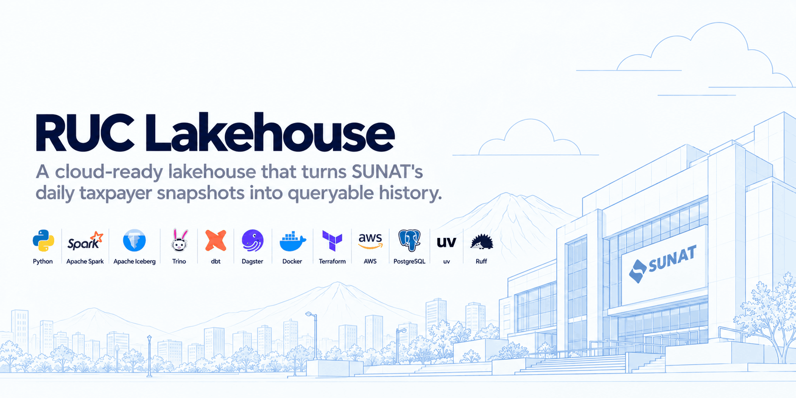
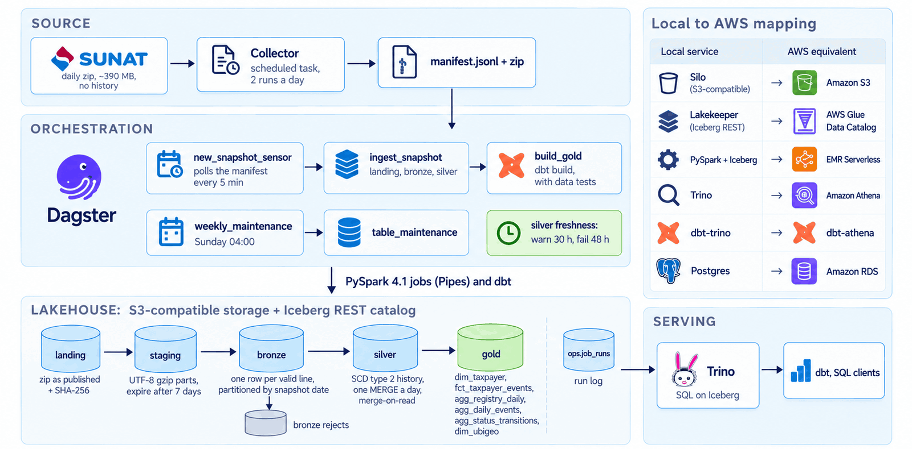
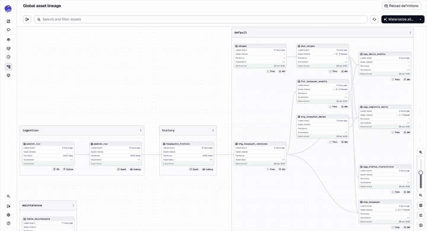

<div align="center">



[](https://github.com/angelariasus/ruc-lakehouse/actions/workflows/ci.yml)
[](LICENSE)
[](#aws-deployment)

[](https://www.python.org/)
[](https://spark.apache.org/)
[](https://iceberg.apache.org/)
[](https://trino.io/)
[](https://www.getdbt.com/)
[](https://dagster.io/)
[](https://www.docker.com/)
[](https://www.terraform.io/)
[](infra/)
[](https://www.postgresql.org/)
[](https://docs.astral.sh/uv/)
[](https://docs.astral.sh/ruff/)
[](.github/workflows/ci.yml)

</div>

SUNAT, Peru's tax administration, publishes only the **current** state of every
taxpayer: one ~390 MB zip, replaced every day, with no history. This project
keeps each snapshot, compares it with the previous one and stores the changes
as Apache Iceberg tables with full history (**SCD type 2**): new taxpayers,
deregistrations, and changes of status, address condition or location.

Everything runs locally in Docker, but only through interfaces AWS offers as
managed services (S3, Glue, EMR Serverless, Athena). The AWS side is written in
Terraform and checked in CI; it is **defined, not deployed**.

## Highlights

- **18.5 million rows per snapshot**, loaded end to end (landing, bronze and
  silver) in about three minutes on a laptop; a daily increment takes 46 seconds
  in silver.
- **SCD type 2 in a single `MERGE`**: only new, changed and removed RUCs are
  written each day, with merge-on-read and no stored row hash.
- **Self-running**: a Dagster sensor detects each new snapshot and runs
  landing, bronze, silver and the dbt gold layer with no manual step.
- **Data contracts and guards**: header check against a schema contract, count
  reconciliation, reject thresholds, in-order dates and a truncated-file guard.
- **Operated like a product**: freshness policy, run log in `ops.job_runs`,
  weekly table maintenance and a runbook.
- **Infrastructure as code**: Terraform validated with `terraform test`
  (mocked provider) and a full apply, idempotency check and destroy against
  Moto.
- **Tested on real data**: the end-to-end CI job loads two consecutive real
  days, not generated ones.

## Contents

- [Architecture](#architecture)
- [Tech stack](#tech-stack)
- [Data flow](#data-flow)
- [Gold models](#gold-models)
- [Orchestration](#orchestration)
- [Operations](#operations)
- [AWS deployment](#aws-deployment)
- [Quick start](#quick-start)
- [Repository layout](#repository-layout)
- [Testing and CI](#testing-and-ci)
- [Limitations](#limitations)
- [Data source](#data-source)
- [License](#license)

## Architecture



Each local service has a managed AWS counterpart, so moving to the cloud is a
configuration change:

| Local service | Role | AWS equivalent |
|---|---|---|
| Silo (S3-compatible storage) | Data lake files | Amazon S3 |
| Lakekeeper | Iceberg REST catalog | AWS Glue Data Catalog (Iceberg REST endpoint) |
| PySpark 4.1 + Iceberg 1.12 | Ingestion and history (bronze, silver) | EMR Serverless |
| Trino | SQL engine | Amazon Athena |
| dbt (dbt-trino) | Gold models and data tests | dbt-athena |
| Dagster | Orchestration: sensors, partitions, run queue | Dagster on ECS or Dagster+ |
| Postgres | Catalog and orchestrator metadata only | Amazon RDS |

The active target is chosen with `LAKE_PROFILE` (`local` or `aws`); see
[`src/ruc_lakehouse/config.py`](src/ruc_lakehouse/config.py).

## Tech stack

| Layer | Technology |
|---|---|
| Table format | Apache Iceberg 1.12 (merge-on-read, partitioned and sorted writes) |
| Processing | PySpark 4.1 |
| SQL engine | Trino 484 |
| Transformation | dbt-core 1.12 with dbt-trino, SQLFluff |
| Orchestration | Dagster 1.13 (dynamic partitions, sensors, schedules, Pipes, freshness policies) |
| Storage and catalog | Silo (S3-compatible), Lakekeeper (Iceberg REST), Postgres 17 |
| Infrastructure | Terraform 1.17, AWS provider 6.x, TFLint, Moto |
| Language and tooling | Python 3.12, uv, Ruff, pytest, pre-commit |
| Packaging and CI | Docker Compose, GitHub Actions |

## Data flow

| Step | Where | What happens |
|---|---|---|
| Collect | outside the repo | A daily task keeps one zip per day, since SUNAT keeps no history |
| Landing | `s3://…/landing/` | The zip exactly as published, with its SHA-256. The header is checked against the [contract](src/ruc_lakehouse/contracts.py), so a schema change stops here |
| Staging | `s3://…/staging/` | The same lines re-chunked into UTF-8 gzip parts: Spark cannot split a zip and would read 1.6 GB in one task |
| Bronze | `bronze.padron_ruc` | One row per valid line, partitioned by snapshot date and sorted by RUC. Broken lines go to `bronze.padron_ruc_rejects` with the reason |
| Silver | `silver.taxpayers_history` | One row per version of each RUC (SCD type 2): `valid_from`, `valid_to`, `is_current`, why it opened (`initial`, `new`, `changed`), which columns changed, and why it closed (`changed`, `removed`) |
| Gold | `gold.*` | dbt models for reporting, see [Gold models](#gold-models) |

Every load reconciles its counts with the landing marker and stops if more than
0.1% of the lines are rejected; each run is recorded in `ops.job_runs`.
Landing and bronze can be re-run safely: the same file is skipped, and bronze
replaces the snapshot's partition.

Silver compares each day with the current versions through a hash of the
attributes and applies only new, changed and removed RUCs in one `MERGE`. Days
are applied in order (the same day again is a no-op, an earlier one is
refused), and a day that would remove more than 1% of the registry is refused
as a probable truncated file. Two design choices keep the daily cost low:

- **Merge-on-read.** Changes land on scattered RUCs, so copy-on-write would
  rewrite nearly every file each day; merge-on-read writes the changes and a
  small delete file, and compaction merges them later.
- **No stored hash.** A SHA-256 per row does not compress: storing it made the
  table 977 MB instead of 323 MB. It is recomputed on both sides at run time.

### What the real data looks like

One real snapshot (2026-10-25): **18,486,442 lines** in a 394 MB zip become
310 MB of Parquet in bronze in about two minutes on a laptop, and the initial
silver load takes another minute and a half. Only one line is rejected
(an `AAAAAAAAAAA` RUC). SUNAT escapes the delimiter inside values (`\|`, and
`\\` for a backslash), as in `EBEN EZER \| INGENIERIA Y ARQUITECTURA S.A.C.`;
a naive split on `|` would lose those taxpayers.

The second real day (2026-10-26), loaded by Dagster's sensor with no manual
step, shows how little changes between snapshots: **228 new taxpayers and 277
with at least one changed attribute** out of 18.5 million, none removed. Bronze
took two minutes, and silver applied the 505 new versions in 46 seconds. The
277 changes are 145 status, 126 address condition, 99 address, 54 location and
2 name changes (one taxpayer can change several columns at once).

The sensor then picked up the next four days on its own. The history now spans
six consecutive snapshots (2026-10-25 to 2026-10-30) and ends with 18,512,116
versions, 18,498,129 of them current, exactly one per RUC:

| Snapshot | New | Changed | Removed | Silver run |
|---|---|---|---|---|
| 2026-10-26 | 228 | 277 | 0 | 45 s |
| 2026-10-27 | 1,658 | 1,795 | 7 | 91 s |
| 2026-10-28 | 3,186 | 3,891 | 0 | 59 s |
| 2026-10-29 | 2,460 | 3,065 | 2 | 63 s |
| 2026-10-30 | 4,165 | 4,950 | 0 | 65 s |

The first removals are real: the 9 RUCs that left the registry (7 on the 27th,
2 on the 29th) were all natural persons whose status was
`NUM. INTERNO IDENTIF`, and their last version closed with
`end_reason = 'removed'`. The most frequent status change every day is
`INHABILITADO-VENT.UN` back to `ACTIVO` (204 on the 27th, 646 on the 30th),
followed by `ACTIVO` to `BAJA DEFINITIVA`.

## Gold models

dbt builds the reporting layer on Trino (`gold` schema), with
[INEI's 2022 list of 1,891 districts](https://www.datosabiertos.gob.pe/dataset/ubigeos-c%C3%B3digos-de-ubicaci%C3%B3n-geogr%C3%A1fica-instituto-nacional-de-estad%C3%ADstica-e-inform%C3%A1tica-inei)
as a seed:

| Model | Grain |
|---|---|
| `dim_taxpayer` | One row per RUC in its current state, with taxpayer type (natural person or legal entity, from the RUC prefix), status group and district |
| `dim_ubigeo` | One row per district |
| `fct_taxpayer_events` | One row per change: registered, removed, or a change of status, address condition, location, name or address, with the value before and after |
| `agg_registry_daily` | Registry size on every snapshot date by type, status, address condition and department |
| `agg_daily_events` | Events per day by type and department |
| `agg_status_transitions` | Daily moves between statuses, e.g. `ACTIVO` to `BAJA DE OFICIO` |

`agg_registry_daily` does not re-read the whole history for every date: each
version adds one to its group on `valid_from` and subtracts one on `valid_to`,
and a running sum gives the size on each date.

Tests cover keys, accepted values, the link to the district list and three
custom checks: one current version per RUC, the daily registry adding up to
the current versions, and no names of natural persons in gold, which only
names legal entities. The district check is a warning: 78 taxpayers carry
codes of districts reorganized after 2016, mostly in Loreto.

On the real snapshot, `dbt build` takes about 40 seconds. Of the 2.37 million
legal entities in the registry, 1.38 million are deregistered and 890,000 are
active, half of them in Lima.

> **Privacy.** RUCs starting with `10` belong to natural persons. Gold exposes
> their RUC only as part of counts and never their names.

## Orchestration



Dagster runs the whole flow on its own once the stack is up:

1. `new_snapshot_sensor` reads the collector's `manifest.jsonl` every five
   minutes. For each stored snapshot it does not know, it adds a partition and
   requests `ingest_snapshot` (landing, bronze, silver), oldest first.
2. `gold_after_ingestion` requests `build_gold` (`dbt build`) after each
   successful ingestion; dbt tests show up as asset checks.
3. `weekly_maintenance` runs the table maintenance early on Sundays (see
   [Operations](#operations)).

Design choices:

- **Dynamic partitions, one per stored snapshot.** SUNAT does not publish every
  day, so a daily calendar would list days with nothing to load. Days whose
  file was identical to the previous one are skipped, as they bring no change.
- **One run at a time** (`QueuedRunCoordinator`): silver applies dates in
  order and every run starts a Spark session.
- **Jobs stay command-line programs.** Each asset runs its job as a separate
  process through Dagster Pipes and the job reports its metrics as
  materialization metadata. Run by hand, the same commands work without
  Dagster. On AWS, the Pipes client is the swap point: `PipesEMRServerlessClient`
  would run the same module on EMR Serverless.

The asset graph runs `landing → bronze → silver → staging → gold`, because
the silver asset has the key dbt gives its source.

## Operations

[`docs/operations.md`](docs/operations.md) covers the daily routine, the
health signals and what to do when a check stops a load. In short:

- **Freshness.** Dagster warns when the history is more than 30 hours old and
  fails after 48.
- **Run log.** Every job records its metrics in `ops.job_runs`, queryable from
  Trino.
- **Weekly maintenance.** On Sundays, bronze keeps its last two weeks, silver's
  daily delete files are compacted, snapshots older than a week expire, and
  orphan files are removed. The first pass on the real lake freed 425 MB of the
  1.17 GB stored.

## AWS deployment

[`infra/`](infra/) defines the AWS side in Terraform: S3 buckets, Glue
databases, an Athena workgroup, an EMR Serverless application with its job
image in ECR, least-privilege IAM and a monthly budget. It is **defined, not
deployed**: there is no AWS account behind this project, so CI checks it in
three steps:

1. Lint: `terraform fmt`, `validate` and TFLint with the AWS rules.
2. Unit tests with a mocked provider. They check, for example, that landing is
   archived but never deleted, and that the Spark jobs cannot write landing or
   gold.
3. A full apply against [Moto](https://github.com/getmoto/moto), an AWS API
   emulator, then a second plan that must be empty, then a destroy.

The job image ([`docker/emr/Dockerfile`](docker/emr/Dockerfile)) builds on EMR
Serverless's own Spark 4.1 image. Locally it runs the smoke job against the
Docker catalog and storage, with AWS's Spark and Iceberg builds. See
[`infra/README.md`](infra/README.md) for the design and the deployment steps.

Deployed, it would cost **about US$9 a month**, nearly all Spark compute, and
nothing between jobs ([estimate](docs/costs.md)).

## Quick start

Requirements: Docker with about 6 GB of free memory.

```bash
cp .env.example .env          # then change the secrets
docker compose up -d --build --wait
docker compose run --rm jobs python -m ruc_lakehouse.jobs.smoke
```

`SNAPSHOTS_HOST_DIR` in `.env` points at the collector's folder
(`manifest.jsonl` and `raw/snapshot_date=YYYY-MM-DD/padron_reducido_ruc.zip`).
Dagster loads every snapshot listed in the manifest on its own. The same steps
also run by hand, for any date in the manifest:

```bash
docker compose run --rm jobs python -m ruc_lakehouse.ingest.landing 2026-10-25
docker compose run --rm jobs python -m ruc_lakehouse.jobs.bronze 2026-10-25
docker compose run --rm jobs python -m ruc_lakehouse.jobs.silver 2026-10-25
docker compose run --rm jobs dbt build
docker compose exec trino trino --execute "select * from lakehouse.gold.agg_registry_daily"
```

Silver applies days in order, so run the earlier dates first.

| Service | URL |
|---|---|
| Storage console | http://localhost:9001 |
| Catalog API | http://localhost:8181 |
| Trino | http://localhost:8080 |
| Dagster | http://localhost:3000 |
| Spark UI (while a job runs) | http://localhost:4040 |

## Repository layout

```text
.
├── src/ruc_lakehouse/
│   ├── ingest/          # landing: zip to S3, re-chunked staging parts
│   ├── jobs/            # bronze, silver (SCD2), maintenance, smoke
│   ├── orchestration/   # Dagster assets, sensors, schedules, dbt wiring
│   ├── reference/       # INEI district list for the dbt seed
│   ├── setup/           # catalog bootstrap
│   ├── contracts.py     # source schema contract
│   └── config.py        # local and aws profiles
├── dbt/                 # staging views, gold models, seed and data tests
├── infra/               # Terraform for the AWS side, with unit and Moto tests
├── docker/              # app, Dagster, Trino, Postgres and EMR images
├── docs/                # operations runbook and cost estimate
├── tests/               # unit tests and the end-to-end sample
└── docker-compose.yml   # the local stack
```

## Testing and CI

```bash
uv sync
uv run pre-commit install
uv run pytest
uv run ruff check . && uv run ruff format --check .
uv run sqlfluff lint dbt/models dbt/tests
uv run dbt parse --project-dir dbt --profiles-dir dbt
```

GitHub Actions runs five jobs on every push:

| Job | What it checks |
|---|---|
| `lint` | Ruff and SQLFluff |
| `test` | Unit tests, including the Spark ones, with S3 mocked by Moto |
| `dbt` | The dbt project parses |
| `infra` | Terraform fmt, validate, TFLint, `terraform test`, and an apply, empty second plan and destroy against Moto |
| `stack` | End to end: starts the whole Docker stack, loads two consecutive real days and checks bronze, silver, gold and the maintenance from Trino |

A runner cannot hold two 394 MB files, so the `stack` job uses a small real
sample, [`tests/e2e/snapshots`](tests/e2e/snapshots): 3,155 legal entities from
2026-10-25 and 2026-10-26, including the 155 that changed and the 39 that
appeared. `tests/e2e/build_sample.py` cuts it from the collector's files. The
unit tests use a few invented lines for the cases a real file almost never has
(a broken line, an escaped delimiter).

## Limitations

- **The CI sample has no removal.** Real removals did show up on the 27th and
  the 29th and closed correctly in the lake, but the sample used by the `stack`
  job covers only 2026-10-25 and 2026-10-26, so in CI that path is tested only
  by the silver unit tests.
- **The AWS side is not deployed.** It is validated against Moto, which is not
  AWS. Open points: where Dagster runs on AWS, the daily download on AWS, and a
  dbt-athena target. See [`infra/README.md`](infra/README.md).
- **The collector is a scheduled task on a laptop.** A day with the machine off
  is a snapshot SUNAT does not hand out again.
- **Little history yet.** The daily churn figures come from six days and
  range from 228 to 4,165 new taxpayers a day, so they say little about a
  normal month.

## Data source

[SUNAT, padrón reducido RUC](https://www.sunat.gob.pe/descargaPRR/mrc137_padron_reducido.html),
public data published by Peru's tax administration. District names:
INEI, *Ubigeos 2022* (ODbL).

## License

[MIT](LICENSE)
