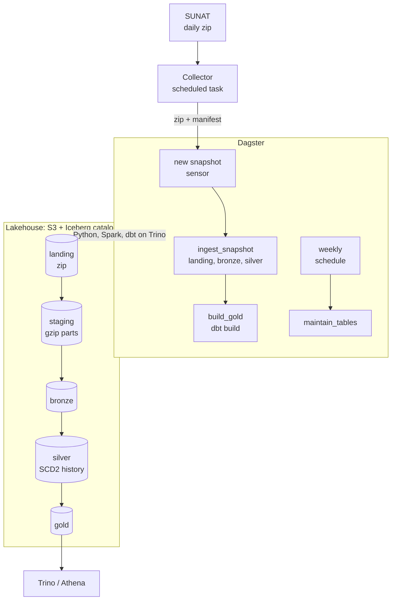

# ruc-lakehouse

Cloud-ready lakehouse that turns SUNAT's daily taxpayer registry snapshots
(*padrón reducido RUC*) into history.

SUNAT publishes only the current state of every taxpayer: one ~390 MB zip,
replaced every day. This project keeps each snapshot, compares it with the
previous one and stores the changes as Iceberg tables with full history
(SCD type 2): new taxpayers, deregistrations, and changes of status, address
condition or location.

> **Status:** all seven phases done; the AWS side is defined and checked, not
> deployed. See [Roadmap](#roadmap).

## Architecture



Everything runs locally in Docker, but only through interfaces AWS offers as
managed services, so moving to the cloud is a configuration change:

| Local service | Role | AWS equivalent |
|---|---|---|
| Silo (S3-compatible storage) | Data lake files | Amazon S3 |
| Lakekeeper | Iceberg REST catalog | AWS Glue Data Catalog (Iceberg REST endpoint) |
| PySpark 4.1 + Iceberg 1.12 | Ingestion and history (bronze, silver) | EMR Serverless |
| Trino | SQL engine | Amazon Athena |
| dbt (dbt-trino) | Gold models and data tests | dbt-athena |
| Dagster | Orchestration: sensors, partitions, run queue | Dagster on ECS or Dagster+ |
| Postgres | Catalog and orchestrator metadata only | Amazon RDS |

The active target is chosen with `LAKE_PROFILE` (`local` or `aws`); see
[`src/ruc_lakehouse/config.py`](src/ruc_lakehouse/config.py). The AWS side is
written in Terraform in [`infra/`](infra/).

## Data flow

| Step | Where | What happens |
|---|---|---|
| Collect | outside the repo | A daily task keeps one zip per day, since SUNAT keeps no history |
| Landing | `s3://…/landing/` | The zip exactly as published, with its SHA-256. The header is checked against the [contract](src/ruc_lakehouse/contracts.py), so a schema change stops here |
| Staging | `s3://…/staging/` | The same lines re-chunked into UTF-8 gzip parts: Spark cannot split a zip and would read 1.6 GB in one task |
| Bronze | `bronze.padron_ruc` | One row per valid line, partitioned by snapshot date and sorted by RUC. Broken lines go to `bronze.padron_ruc_rejects` with the reason |
| Silver | `silver.taxpayers_history` | One row per version of each RUC (SCD type 2): `valid_from`, `valid_to`, `is_current`, why it opened (`initial`, `new`, `changed`), which columns changed, and why it closed (`changed`, `removed`) |

Every load reconciles its counts with the landing marker and stops if more than
0.1% of the lines are rejected; each run is recorded in `ops.job_runs`.
Landing and bronze can be re-run safely: the same file is skipped, and bronze
replaces the snapshot's partition.

Silver compares each day with the current versions through a hash of the
attributes and applies only new, changed and removed RUCs in one `MERGE`. Days
are applied in order (the same day again is a no-op, an earlier one is
refused), and a day that would remove more than 1% of the registry is refused
as a probable truncated file. Two design choices keep the daily cost low:

- **Merge-on-read.** Changes land on scattered RUCs, so copy-on-write would
  rewrite nearly every file each day; merge-on-read writes the changes and a
  small delete file, and compaction merges them later.
- **No stored hash.** A SHA-256 per row does not compress: storing it made the
  table 977 MB instead of 323 MB. It is recomputed on both sides at run time.

One real snapshot (2026-10-25): **18,486,442 lines** in a 394 MB zip become
310 MB of Parquet in bronze in about two minutes on a laptop, and the initial
silver load takes another minute and a half. Only one line is rejected
(an `AAAAAAAAAAA` RUC). SUNAT escapes the delimiter inside values (`\|`, and
`\\` for a backslash), as in `EBEN EZER \| INGENIERIA Y ARQUITECTURA S.A.C.`;
a naive split on `|` would lose those taxpayers.

The second real day (2026-10-26), loaded by Dagster's sensor with no manual
step, shows how little changes between snapshots: **228 new taxpayers and 277
with at least one changed attribute** out of 18.5 million, none removed. Bronze
took two minutes, and silver applied the 505 new versions in 46 seconds. The
277 changes are 145 status, 126 address condition, 99 address, 54 location and
2 name changes (one taxpayer can change several columns at once).

## Gold models

dbt builds the reporting layer on Trino (`gold` schema), with
[INEI's 2022 list of 1,891 districts](https://www.datosabiertos.gob.pe/dataset/ubigeos-c%C3%B3digos-de-ubicaci%C3%B3n-geogr%C3%A1fica-instituto-nacional-de-estad%C3%ADstica-e-inform%C3%A1tica-inei)
as a seed:

| Model | Grain |
|---|---|
| `dim_taxpayer` | One row per RUC in its current state, with taxpayer type (natural person or legal entity, from the RUC prefix), status group and district |
| `dim_ubigeo` | One row per district |
| `fct_taxpayer_events` | One row per change: registered, removed, or a change of status, address condition, location, name or address, with the value before and after |
| `agg_registry_daily` | Registry size on every snapshot date by type, status, address condition and department |
| `agg_daily_events` | Events per day by type and department |
| `agg_status_transitions` | Daily moves between statuses, e.g. `ACTIVO` to `BAJA DE OFICIO` |

`agg_registry_daily` does not re-read the whole history for every date: each
version adds one to its group on `valid_from` and subtracts one on `valid_to`,
and a running sum gives the size on each date.

Tests cover keys, accepted values, the link to the district list and three
custom checks: one current version per RUC, the daily registry adding up to
the current versions, and no names of natural persons in gold, which only
names legal entities. The district check is a warning: 78 taxpayers carry
codes of districts reorganized after 2016, mostly in Loreto.

On the real snapshot, `dbt build` takes about 40 seconds. Of the 2.37 million
legal entities in the registry, 1.38 million are deregistered and 890,000 are
active, half of them in Lima.

## Orchestration

Dagster runs the whole flow on its own once the stack is up:

1. `new_snapshot_sensor` reads the collector's `manifest.jsonl` every five
   minutes. For each stored snapshot it does not know, it adds a partition and
   requests `ingest_snapshot` (landing, bronze, silver), oldest first.
2. `gold_after_ingestion` requests `build_gold` (`dbt build`) after each
   successful ingestion; dbt tests show up as asset checks.
3. `weekly_maintenance` runs the table maintenance early on Sundays (see
   [Operations](#operations)).

Design choices:

- **Dynamic partitions, one per stored snapshot.** SUNAT does not publish every
  day, so a daily calendar would list days with nothing to load. Days whose
  file was identical to the previous one are skipped, as they bring no change.
- **One run at a time** (`QueuedRunCoordinator`): silver applies dates in
  order and every run starts a Spark session.
- **Jobs stay command-line programs.** Each asset runs its job as a separate
  process through Dagster Pipes and the job reports its metrics as
  materialization metadata. Run by hand, the same commands work without
  Dagster. On AWS, the Pipes client is the swap point: `PipesEMRServerlessClient`
  would run the same module on EMR Serverless.

The asset graph runs `landing → bronze → silver → staging → gold`, because
the silver asset has the key dbt gives its source.

## Operations

[`docs/operations.md`](docs/operations.md) covers the daily routine, the
health signals and what to do when a check stops a load. In short:

- **Freshness.** Dagster warns when the history is more than 30 hours old and
  fails after 48.
- **Run log.** Every job records its metrics in `ops.job_runs`, queryable from
  Trino.
- **Weekly maintenance.** On Sundays, bronze keeps its last two weeks, silver's
  daily delete files are compacted, snapshots older than a week expire, and
  orphan files are removed. The first pass on the real lake freed 425 MB of the
  1.17 GB stored.

## AWS deployment

[`infra/`](infra/) defines the AWS side in Terraform: S3 buckets, Glue
databases, an Athena workgroup, an EMR Serverless application with its job
image in ECR, least-privilege IAM and a monthly budget. It is **defined, not
deployed**: there is no AWS account behind this project, so CI checks it in
three steps:

1. Lint: `terraform fmt`, `validate` and TFLint with the AWS rules.
2. Unit tests with a mocked provider. They check, for example, that landing is
   archived but never deleted, and that the Spark jobs cannot write landing or
   gold.
3. A full apply against [Moto](https://github.com/getmoto/moto), an AWS API
   emulator, then a second plan that must be empty, then a destroy.

The job image ([`docker/emr/Dockerfile`](docker/emr/Dockerfile)) builds on EMR
Serverless's own Spark 4.1 image. Locally it runs the smoke job against the
Docker catalog and storage, with AWS's Spark and Iceberg builds. See
[`infra/README.md`](infra/README.md) for the design and the deployment steps.

Deployed, it would cost **about US$9 a month**, nearly all Spark compute, and
nothing between jobs ([estimate](docs/costs.md)).

## Quick start

Requirements: Docker with about 6 GB of free memory.

```bash
cp .env.example .env          # then change the secrets
docker compose up -d --build --wait
docker compose run --rm jobs python -m ruc_lakehouse.jobs.smoke
```

`SNAPSHOTS_HOST_DIR` in `.env` points at the collector's folder
(`manifest.jsonl` and `raw/snapshot_date=YYYY-MM-DD/padron_reducido_ruc.zip`).
Dagster loads every snapshot listed in the manifest on its own. The same steps
also run by hand, for any date in the manifest:

```bash
docker compose run --rm jobs python -m ruc_lakehouse.ingest.landing 2026-10-25
docker compose run --rm jobs python -m ruc_lakehouse.jobs.bronze 2026-10-25
docker compose run --rm jobs python -m ruc_lakehouse.jobs.silver 2026-10-25
docker compose run --rm jobs dbt build
docker compose exec trino trino --execute "select * from lakehouse.gold.agg_registry_daily"
```

Silver applies days in order, so run the earlier dates first.

| Service | URL |
|---|---|
| Storage console | http://localhost:9001 |
| Catalog API | http://localhost:8181 |
| Trino | http://localhost:8080 |
| Dagster | http://localhost:3000 |
| Spark UI (while a job runs) | http://localhost:4040 |

## Development

```bash
uv sync
uv run pre-commit install
uv run pytest
uv run ruff check . && uv run ruff format --check .
uv run sqlfluff lint dbt/models dbt/tests
uv run dbt parse --project-dir dbt --profiles-dir dbt
```

CI runs the same checks plus the Terraform ones. The unit tests use a few
invented lines for the cases a real file almost never has (a broken line, an
escaped delimiter). Full loads are checked locally against the collector's real
snapshots, since a runner cannot hold two 394 MB files.

The district seed is rebuilt from INEI's file with
`uv run python -m ruc_lakehouse.reference.ubigeo dbt/seeds/ubigeo.csv`.

## Roadmap

- [x] Phase 1: local stack (storage, catalog, Spark, Trino) and CI
- [x] Phase 2: bronze, snapshots loaded as Iceberg tables with a schema contract
- [x] Phase 3: silver, daily diff and SCD type 2 history
- [x] Phase 4: gold, dbt models on Trino with data tests
- [x] Phase 5: orchestration with Dagster (sensors, partitions, run queue)
- [x] Phase 6: AWS infrastructure as code with Terraform (defined, checked against Moto)
- [x] Phase 7: table maintenance, observability and documentation

## Data source

[SUNAT, padrón reducido RUC](https://www.sunat.gob.pe/descargaPRR/mrc137_padron_reducido.html),
public data published by Peru's tax administration. District names:
INEI, *Ubigeos 2022* (ODbL).

## License

[MIT](LICENSE)
